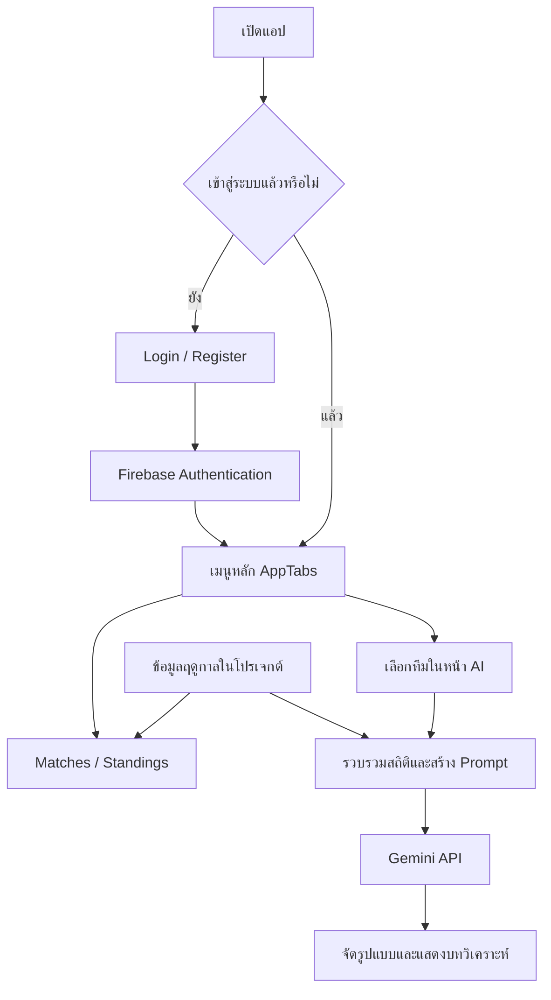

# Premier League Vision AI

แอปพลิเคชันแสดงข้อมูลและวิเคราะห์การแข่งขันฟุตบอลพรีเมียร์ลีก พัฒนาด้วย React Native และ Expo รองรับการเปิดผ่านเว็บ และมีการตั้งค่าสำหรับสร้างแอป Android

โปรเจกต์นี้รวบรวมโปรแกรมการแข่งขัน ผลการแข่งขัน ตารางคะแนน และบทวิเคราะห์ไว้ในแอปเดียว ผู้ใช้สามารถเลือกทีมเหย้าและทีมเยือนเพื่อให้ AI วิเคราะห์จากสถิติและข้อมูลนักเตะที่แอปเตรียมให้ โดยแยกข้อมูลการแข่งขันออกจากส่วนที่ AI คาดการณ์ เช่น รายชื่อผู้เล่นที่คาดว่าจะลงสนาม โอกาสชนะ และสกอร์

## วิดีโอแนะนำการใช้งาน

[ชมคลิปแนะนำการใช้งานแอป](https://youtu.be/Dffq5wLXI-A)

## ความสามารถหลัก

- สมัครสมาชิก เข้าสู่ระบบ ออกจากระบบ และขอรีเซ็ตรหัสผ่านผ่าน Firebase Authentication
- แสดงโปรแกรมการแข่งขัน ผลการแข่งขัน และตารางคะแนนพรีเมียร์ลีก
- วิเคราะห์คู่แข่งขันจากข้อมูลทีมและการแข่งขันด้วย Google Gemini พร้อมแสดงบทวิเคราะห์ภาษาไทย
- มีสคริปต์อัปเดตข้อมูลฤดูกาล ซิงก์ข้อมูลเข้า Firestore และประเมินผลการทำนายย้อนหลัง

## เทคโนโลยีที่ใช้

| เทคโนโลยี | หน้าที่ในโปรเจกต์ |
| --- | --- |
| React Native และ Expo | สร้างหน้าจอและรันแอปบนเว็บหรืออุปกรณ์มือถือ |
| React Navigation | จัดการหน้าล็อกอินและเมนูแท็บหลัก |
| Firebase Authentication | จัดการบัญชีและสถานะการเข้าสู่ระบบ |
| Cloud Firestore | จัดเก็บข้อมูลฟุตบอลสำหรับส่วนซิงก์ข้อมูลและตัวโหลดข้อมูลที่เตรียมไว้ |
| Firebase Cloud Functions | ให้บริการ API และงานซิงก์ข้อมูลฝั่งเซิร์ฟเวอร์ |
| Google Gemini API | สร้างบทวิเคราะห์ภาษาไทยจากข้อมูลที่ส่งให้ |
| football-data.org | แหล่งข้อมูลฟุตบอลที่สคริปต์และ backend ใช้ดึงข้อมูล |

## โครงสร้างโปรเจกต์

```text
ai/             การวิเคราะห์การแข่งขันและการเรียก Gemini
assets/         รูปภาพและไอคอนของแอป
auth/           หน้าสมัครสมาชิกและเข้าสู่ระบบ
backtesting/    รายงานและผลการประเมินย้อนหลัง
data/           ข้อมูลพรีเมียร์ลีกและฟังก์ชันอ่านข้อมูล
functions/      Firebase Cloud Functions และสคริปต์ซิงก์ข้อมูล
screens/        หน้ารายการแข่งขัน ตารางคะแนน และ AI
scripts/        เครื่องมืออัปเดตข้อมูลและประเมินผล
App.js          จุดเริ่มต้นของหน้าจอและระบบนำทาง
firebase.js     การตั้งค่า Firebase Authentication
firebaseConfig.js การตั้งค่า Firestore สำหรับข้อมูลฟุตบอล
```

## ลำดับการทำงานของแอป

1. `index.js` ลงทะเบียนแอป แล้วเปิดคอมโพเนนต์หลักใน `App.js`
2. `App.js` ติดตามสถานะด้วย `onAuthStateChanged()` หากยังไม่เข้าสู่ระบบจะแสดงหน้า Login/Register และเมื่อเข้าสู่ระบบแล้วจะแสดง `AppTabs`
3. ผู้ใช้เลือกแท็บ Matches, AI หรือ Standings เพื่อดูรายการแข่งขัน วิเคราะห์คู่แข่งขัน หรือดูตารางคะแนน
4. ในหน้า AI ผู้ใช้เลือกทีมเหย้าและทีมเยือน แล้วกดวิเคราะห์ ระบบตรวจข้อมูล รวบรวมสถิติ และสร้างคำสั่งส่งให้ Gemini
5. เมื่อได้คำตอบ ระบบจัดหัวข้อผลการพบกันจากข้อมูลต้นทาง แล้วจัดรูปแบบบทวิเคราะห์ให้อ่านง่ายบนหน้าจอ



## อธิบายโค้ดหลักแบบคร่าว ๆ

| ไฟล์ | โค้ดส่วนนี้ทำอะไร |
| --- | --- |
| [`index.js`](index.js) | ลงทะเบียนคอมโพเนนต์หลักกับ Expo เพื่อเริ่มแอป |
| [`App.js`](App.js) | ตรวจสถานะผู้ใช้ สลับหน้าล็อกอินกับหน้าหลัก และปรับกรอบแสดงผลบนเว็บ |
| [`auth/LoginScreen.jsx`](auth/LoginScreen.jsx) | รับอีเมลและรหัสผ่าน เรียก `signInWithEmailAndPassword()` และส่งอีเมลรีเซ็ตรหัสผ่าน |
| [`auth/RegisterScreen.jsx`](auth/RegisterScreen.jsx) | รับข้อมูลสมัครสมาชิก ตรวจรหัสผ่านยืนยัน และเรียก `createUserWithEmailAndPassword()` |
| [`screens/AppTabs.jsx`](screens/AppTabs.jsx) | สร้างเมนูแท็บด้านล่าง เชื่อมแต่ละหน้าจอ และเรียก `signOut()` เมื่อออกจากระบบ |
| [`screens/MatchesScreenFixed.jsx`](screens/MatchesScreenFixed.jsx) | อ่านรายการแข่งขัน เก็บข้อมูลใน state และกรองแมตช์ตามชื่อทีมที่ค้นหา |
| [`screens/StandingsScreenSync.jsx`](screens/StandingsScreenSync.jsx) | อ่านตารางคะแนนแล้วแสดงอันดับ คะแนน และสถิติของแต่ละทีม |
| [`screens/AIScreenData.jsx`](screens/AIScreenData.jsx) | รับหรือสลับทีมที่เลือก เรียกฟังก์ชันวิเคราะห์ แสดงสถานะกำลังโหลด และจัดรูปแบบคำตอบทีละบรรทัด |
| [`ai/dataDrivenAnalysisV3.js`](ai/dataDrivenAnalysisV3.js) | ตรวจชื่อทีม รวบรวมข้อมูล สร้าง Prompt เรียก Gemini และแปลงข้อผิดพลาดเป็นข้อความภาษาไทย |
| [`data/premierLeagueData.js`](data/premierLeagueData.js) | รวมฟังก์ชันอ่านแมตช์ ตารางคะแนน ชื่อทีม และนักเตะ รวมถึงตัวโหลด Firestore ที่มีข้อมูลในไฟล์เป็น fallback |
| [`data/premierLeagueSeason.json`](data/premierLeagueSeason.json) | เก็บ snapshot ข้อมูลฤดูกาลปัจจุบัน ข้อมูลย้อนหลัง ตารางคะแนน และทีม |
| [`functions/index.js`](functions/index.js) | เตรียม API ฝั่งเซิร์ฟเวอร์ ฟังก์ชันซิงก์ข้อมูลทันที และงานซิงก์ตามเวลา |
| [`scripts/refreshSeasonData.js`](scripts/refreshSeasonData.js) | ดึงและปรับปรุงข้อมูลฤดูกาลจากแหล่งข้อมูลฟุตบอล |
| [`scripts/runGeminiBacktest.js`](scripts/runGeminiBacktest.js) | ทำนายแมตช์ย้อนหลัง เปรียบเทียบกับผลจริง และส่งออกผลกับค่าประเมิน |

### ส่วนวิเคราะห์ AI ใน `dataDrivenAnalysisV3.js`

ฟังก์ชันหลักคือ `predictMatchFromFootballData(home, away)` ซึ่งหน้า AI เรียกใช้ โดยทำงานร่วมกับฟังก์ชันย่อยดังนี้:

- `normalizeTeamName()` และ `findStanding()` ปรับชื่อหรือชื่อย่อของทีม แล้วค้นหาทีมนั้นในตารางคะแนน
- `buildFootballContext()` รวมอันดับ คะแนน ประตูได้เสีย ฟอร์มล่าสุด รายชื่อนักเตะ และผลการพบกัน โดยเลือกข้อมูลจากฤดูกาลปัจจุบันกับ 4 ฤดูกาลก่อนหน้าเท่าที่มีอยู่
- `getRecentMatches()` เลือกแมตช์ที่จบแล้วล่าสุดสูงสุด 10 นัดของแต่ละทีม และ `getHeadToHeadMatches()` เลือกนัดที่สองทีมพบกันจากช่วงข้อมูลนั้น
- `buildThaiAnalysisPrompt()` สร้างคำสั่งให้ Gemini เขียนภาษาไทย 7 หัวข้อ ได้แก่ ภาพรวมเกม ตารางคะแนน ฟอร์มล่าสุด ผลการพบกัน ผู้เล่นที่คาดว่าจะลงสนาม โอกาสชนะ และสกอร์ที่คาด
- `generateAnalysis()` ส่งคำขอไปยัง Gemini และลองใหม่เมื่อเกิดข้อผิดพลาดชั่วคราว โดยเรียกได้สูงสุด 3 ครั้งรวมครั้งแรก
- `includeHeadToHeadSection()` ใส่รายการผลการพบกันจากข้อมูลที่เตรียมไว้ในหัวข้อ 4 เพื่อให้แสดงครบแม้ AI จะย่อคำตอบ
- `describeAnalysisError()` แปลงปัญหาจาก API เช่น สิทธิ์ใช้งานหรือโควตา เป็นข้อความที่ผู้ใช้เข้าใจได้

**เส้นทางที่ใช้อยู่ในเวอร์ชันนี้:** หน้ารายการแข่งขัน ตารางคะแนน และฟังก์ชันวิเคราะห์ AI อ่านข้อมูลผ่านกลุ่ม `getPremierLeague...()` จาก snapshot ในโปรเจกต์ จากนั้น AI เรียก Gemini โดยตรง ส่วนกลุ่ม `loadPremierLeague...ForAI()` ที่อ่าน Firestore และ API ใน `functions/` มีเตรียมไว้ แต่ไม่ได้อยู่ในเส้นทางเรียกของหน้า AI ปัจจุบัน การซิงก์ Firestore จึงไม่ได้เปลี่ยน snapshot ที่หน้าจอเหล่านี้ใช้อัตโนมัติ

### ส่วนประเมินผลย้อนหลัง

`scripts/runGeminiBacktest.js` เตรียมสถิติก่อนเวลาเริ่มแข่งขันของแต่ละแมตช์ ส่งให้ Gemini ทำนายผลเป็นทีมเหย้าชนะ เสมอ หรือทีมเยือนชนะ แล้วเทียบกับผลจริง โปรแกรมส่งออกข้อมูล JSON/CSV พร้อม confusion matrix และค่า Accuracy, Precision, Recall และ F1 ส่วน `scripts/interpretConfusionMatrix.js` ใช้สรุปผลจากไฟล์ประเมิน

## วิธีติดตั้งและรันบนเว็บ

ต้องมี Node.js และ npm ในเครื่อง โดยเครื่องที่ใช้พัฒนาโปรเจกต์นี้ใช้ Node.js 22.20.0

1. ดาวน์โหลดหรือ clone repository แล้วเปิด Terminal ในโฟลเดอร์ที่มี `package.json` หากใช้ไฟล์ ZIP ให้แตกไฟล์ก่อน
2. ติดตั้ง dependencies:

   ```sh
   npm ci
   ```

3. คัดลอก `.env.example` เป็น `.env.local` เช่น ใน PowerShell:

   ```powershell
   Copy-Item .env.example .env.local
   ```

4. ใส่ค่าของตนเองใน `.env.local`:

   ```dotenv
   EXPO_PUBLIC_GEMINI_API_KEY=your_gemini_api_key
   EXPO_PUBLIC_FOOTBALL_DATA_API_TOKEN=your_football_data_token
   ```

   `EXPO_PUBLIC_GEMINI_API_KEY` ใช้กับการวิเคราะห์ AI ส่วน token ข้อมูลฟุตบอลใช้กับสคริปต์ดึงข้อมูลฤดูกาล หากไม่ได้ตั้งค่า Gemini จะไม่สามารถสร้างบทวิเคราะห์ AI ได้

5. เริ่มแอป:

   ```sh
   npm run web
   ```

   เปิด URL ที่ Expo แสดงใน Terminal หากแก้ไข `.env.local` ให้หยุดแล้วเริ่ม Expo ใหม่

## การเชื่อมต่อ Firebase

โปรเจกต์มีการตั้งค่า Firebase ของผู้พัฒนาอยู่ใน `firebase.js` และ `firebaseConfig.js` การเข้าสู่ระบบต้องใช้อินเทอร์เน็ตและบริการ Firebase ที่เปิดใช้งานอยู่ หากใช้ Firebase ของตนเอง ให้แก้ไขการตั้งค่าทั้งสองไฟล์ เปิดใช้งาน Email/Password ใน Authentication และตั้งค่า Firestore พร้อมสิทธิ์อ่าน/เขียนให้เหมาะสม

แอปมีข้อมูลฤดูกาลใน `data/premierLeagueSeason.json` และมีตัวโหลดข้อมูลที่ใช้ Firestore พร้อม fallback เป็นข้อมูลในโปรเจกต์ตามที่อธิบายข้างต้น หน้าจอปัจจุบันใช้ snapshot จึงต้องอัปเดตไฟล์ข้อมูลและรันหรือ build แอปใหม่เพื่อให้ข้อมูลที่รวมอยู่ในแอปเปลี่ยนตาม

สำหรับผู้ที่ต้องการใช้งานหรือ deploy backend ของตนเอง ให้ติดตั้ง dependencies เพิ่มด้วย `npm --prefix functions ci` ตั้งค่า Firebase CLI และ secrets ชื่อ `FOOTBALL_DATA_API_TOKEN` กับ `GEMINI_API_KEY` ตามที่ใช้ใน `functions/index.js` โดยดูชื่อตัวแปรตัวอย่างได้ใน `functions/.secret.local.example`

## คำสั่งที่ใช้บ่อย

| คำสั่ง | การทำงาน |
| --- | --- |
| `npm start` | เริ่ม Expo development server |
| `npm run web` | เริ่มแอปสำหรับเว็บ |
| `npm run android` | เริ่มแอปบน Android ที่เตรียมอุปกรณ์หรือ emulator ไว้แล้ว |
| `npm run build:web` | สร้างไฟล์เว็บใน `dist/` |
| `npm run refresh:season-data` | ดึงข้อมูลฤดูกาลด้วย API token ที่ตั้งค่าไว้ |
| `npm run backtest:gemini` | ประเมินการทำนาย Gemini ย้อนหลัง โดยต้องมี API key และโควตา |
| `npm run backtest:interpret` | สรุปผล confusion matrix จากผลที่มีอยู่ |

## ข้อมูลสำหรับการตรวจโปรเจกต์

- เริ่มตรวจโค้ดได้จาก `App.js`, `screens/AIScreenData.jsx` และ `ai/dataDrivenAnalysisV3.js` ตามลำดับการเรียกใช้งาน
- ไฟล์ ZIP ที่อัปโหลดก่อนหน้านี้เป็นสำเนา ณ เวลาที่สร้าง ส่วนไฟล์ใน repository อาจมีการปรับปรุงเพิ่มเติม
- `backtesting/demo-results/` เป็นข้อมูลจำลองสำหรับสาธิตรูปแบบรายงานเท่านั้น ไม่ใช่ผลประเมิน AI จริง ส่วนผลที่ส่งออกจากการประเมินอยู่ใน `backtesting/results/`
- ผลวิเคราะห์ AI เป็นการคาดการณ์จากข้อมูลที่มี ไม่รับประกันผลการแข่งขัน
- ไม่รวม `node_modules/`, `.env.local`, credentials, แคช และไฟล์ build ใน source code ที่อัปโหลด
- ค่าที่ขึ้นต้นด้วย `EXPO_PUBLIC_` จะถูกรวมในแอปฝั่งผู้ใช้ จึงควรใช้คีย์ที่จำกัดการใช้งานเหมาะกับ client และไม่ใส่คีย์ฝั่งเซิร์ฟเวอร์ในตัวแปรเหล่านี้

## ผู้พัฒนา

[phongdanai66](https://github.com/phongdanai66)
